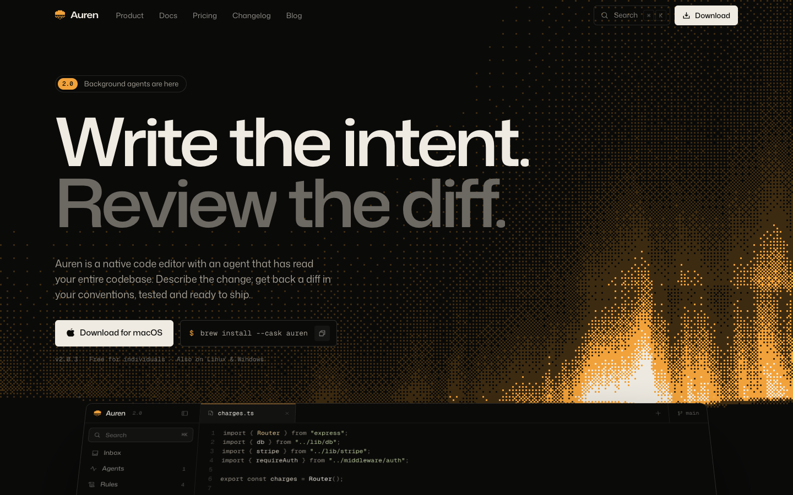

<div align="center">

# Auren

**A landing site for a fictional AI code editor, built around ordered dithering.**

Next.js 16 · React 19 · TypeScript · Tailwind CSS v4 · Motion · Lenis · Phosphor Icons



</div>

---

Auren is a complete, open-source marketing site for an imaginary product: a native code editor with an agent that has read your whole codebase. It exists to show what a landing page can feel like when it commits to one idea. Here the idea is the **8×8 Bayer matrix**: every gradient, transition, cover image and social card is an ordered dither.

It is not a template with lorem ipsum. Every page has real copy, every link goes somewhere, and the product demo in the hero is a working miniature editor you can type into.

## Contents

- [Highlights](#highlights)
- [Quick start](#quick-start)
- [Project structure](#project-structure)
- [How the dithering works](#how-the-dithering-works)
- [The interactive editor](#the-interactive-editor)
- [Customising](#customising)
- [Before you ship it](#before-you-ship-it)
- [Accessibility and performance](#accessibility-and-performance)
- [Troubleshooting](#troubleshooting)
- [Credits and licences](#credits-and-licences)

## Highlights

**Dithering everywhere, rendered three ways**

- **WebGL shaders** draw live, cursor-reactive scenes (an aurora, a raymarched torus, a rising sun) at low resolution and scale them up with nearest-neighbour sampling, so every dot stays crisp on any display.
- **SVG dither tiles**, generated on the server, act as CSS masks. They power the seams between dark and light sections, progress bars, the brand page swatches and a "dither dissolve" entrance used across the site.
- **Procedural dither art** produces every blog cover and every Open Graph image from a handful of scalar fields. There are no image assets.

**Motion with a purpose**

- Headlines rise word by word, mono labels decode from noise, numbers count up, and the privacy statement lights up word by word as you scroll.
- The product section pins while four interactive demos cross-dissolve through a dither mask.
- The hero editor tilts back into place as you scroll, and pages ease in on navigation.
- Every animation respects `prefers-reduced-motion`.

**Things to click**

- A working editor demo: type, take Tab predictions, run agent tasks, keep or drop individual changes, open files, switch models and modes. See [The interactive editor](#the-interactive-editor).
- A <kbd>⌘</kbd> <kbd>K</kbd> command menu that jumps to any page, copies the install command or switches the accent.
- Three accent themes (Aurum, Aurora, Ember) that recolour the shaders live.
- A particle wordmark that scatters away from your cursor and settles back.

**Fourteen routes, all static**

Home, Download (detects your OS), Pricing (with a full comparison and FAQ), Changelog, Docs (eight pages with a scroll-aware table of contents), Blog (four posts), About, Careers (filterable roles), Security, Status (90-day uptime bars), Brand (downloadable logo SVGs, click-to-copy colours) and three legal pages. Each one has its own generated Open Graph image.

## Quick start

Requires **Node.js 20.9 or newer**.

```bash
npm install
npm run dev        # http://localhost:3000
```

| Script          | What it does                               |
| --------------- | ------------------------------------------ |
| `npm run dev`   | Development server with Turbopack          |
| `npm run build` | Production build, prerendering every route |
| `npm start`     | Serve the production build                 |
| `npm run lint`  | ESLint with the Next.js and React rules    |

### Environment variables

| Variable               | Required   | Purpose                                                                                                                                                               |
| ---------------------- | ---------- | --------------------------------------------------------------------------------------------------------------------------------------------------------------------- |
| `NEXT_PUBLIC_SITE_URL` | Production | Absolute origin used for Open Graph and Twitter image URLs, for example `https://auren.example`. On Vercel the production domain is detected automatically if unset. |

## Project structure

```
app/
  layout.tsx               Fonts, metadata, nav, footer, providers
  template.tsx             Fade-in between client-side navigations
  page.tsx                 Home page, assembled from components/sections
  opengraph-image.tsx      One per route; dynamic ones under [slug]
  docs/ blog/ legal/       Dynamic routes with generateStaticParams
  ...                      download, pricing, changelog, about, careers,
                           security, status, brand, not-found
components/
  dither/                  WebGL shader canvas, GLSL scenes, particle wordmark
  editor/                  The interactive editor demo (see below)
  sections/                Home page sections, nav and footer
  site/                    Shared page parts: page hero, content blocks,
                           table of contents, docs nav, uptime bars, brand kit
  ui/                      Reveal animations, buttons, accordion, dither art
  command-palette.tsx      The ⌘K menu
lib/
  dither.ts                Bayer matrix, dither tiles, ramps, the logo glyph
  dither-art.ts            Scalar fields for covers and social cards
  og.tsx                   Shared Open Graph card renderer
  metadata.ts              Site URL, names and per-page social metadata
  routes.ts                Nav, footer and social links in one place
  content/                 All long-form content: docs, blog, changelog,
                           pricing, careers, legal, status, downloads
assets/fonts/              Static fonts for Open Graph images, with licences
```

## How the dithering works

### The matrix

`lib/dither.ts` builds the classic 8×8 Bayer threshold matrix recursively. A pixel is "on" when the value it should show is greater than the threshold at its position. Repeating the matrix turns any value between 0 and 1 into an even pattern of dots.

### Live shaders

`components/dither/dither-shader.tsx` is a small WebGL wrapper. Each scene in `shaders.ts` computes a brightness value per pixel; a shared `dither()` function quantises it into four inks with the Bayer threshold:

```glsl
float t = bayer8(gl_FragCoord.xy);
float s = clamp(v, 0.0, 1.0) * 3.0;
float i = floor(s) + step(t, fract(s));   // 0..3: ink, deep accent, accent, paper
```

The canvas renders at a fraction of the CSS size and is scaled up with `image-rendering: pixelated`. Each dot is snapped to a whole number of device pixels, so the pattern never shimmers. Shaders read their inks from CSS custom properties, which is why switching the accent theme recolours them instantly. They pause when off-screen or when the tab is hidden.

### Masks and tiles

For static dithering the site generates tiny SVGs on the server: an 8×8 tile with *n* of 64 pixels lit. Used as `mask-image`, a tile lets any colour, including the theme accent, show through as dots.

- **Seams** (`DitherBand`) are tall ramps that go from empty to solid, with an accent seam peaking in the middle.
- **The dissolve** (`DitherReveal`) steps an element's mask through all 65 levels in Bayer order, so content appears dot by dot instead of fading.

### Covers and social cards

`lib/dither-art.ts` defines four fields (`sun`, `waves`, `rings`, `grid`) and dithers them into two SVG paths. The same function draws blog covers in the browser and Open Graph images through `next/og`.

## The interactive editor

The hero demo lives in `components/editor/` and plays a scripted session as it scrolls into view, then hands control to you.

| File               | Role                                                                                                     |
| ------------------ | -------------------------------------------------------------------------------------------------------- |
| `session.ts`       | The recorded tasks: the base file, a unified diff per task, steps, review notes and replies             |
| `workspace.ts`     | Everything around it: file contents, tree, inbox, rules, past sessions, models, modes, Tab predictions |
| `editor-demo.tsx`  | State, the timeline, sidebar, tabs and status bar                                                        |
| `code-editor.tsx`  | A small text editor: cursor, typing, keyboard navigation, undo, Tab predictions                          |
| `session-view.tsx` | The agent transcript and the hunk-by-hunk review pane                                                    |
| `composer.tsx`     | The request box with attachments, `@` mentions, `/` commands, model and mode menus                       |
| `panels.tsx`       | Inbox, Agents, Rules and read-only past sessions                                                         |

Things to try:

- Click into `charges.ts` and type. Start a line with `await db.` or `logger.` and press <kbd>Tab</kbd>. <kbd>⌘</kbd> <kbd>Z</kbd> undoes.
- Type `/` in the request box for commands, or `@` to attach a file. Free text such as "make retries safe" is matched to the closest recorded task.
- Switch the mode to **Ask** and the agent answers with a plan instead of editing; **Pair** applies to your current branch.
- Drop a change in the review pane, then accept. Only what you kept lands in the file.

To add a task, append an entry to `TASKS` in `session.ts`. Its diff must apply cleanly to `BASE`, and it needs one note per change.

## Customising

- **Colours and themes.** Tokens live at the top of `app/globals.css`. Accent themes are defined there and listed in `THEMES` in `lib/site.ts`.
- **Type.** Fonts are loaded with `next/font` in `app/layout.tsx`. `type-display`, `type-title` and `type-label` in `globals.css` hold the type scale.
- **Copy and pages.** Long-form content is plain data in `lib/content/`. Add a docs page to `DOCS` and `DOC_NAV`, a post to `POSTS`, or a release to `RELEASES`, and the routes, navigation and social images follow.
- **Navigation.** `lib/routes.ts` drives the nav, the footer and the social links. The command menu's page list is in `components/command-palette.tsx`.
- **Social images.** Edit the card layout once in `lib/og.tsx`; each route's `opengraph-image.tsx` only supplies its text and art.

## Before you ship it

Auren is fictional, so a few things point at placeholders:

- **Downloads.** Buttons in `lib/content/downloads.ts` link to sections of the Download page. Replace each `href` with a real artifact URL.
- **Social links** in `lib/routes.ts` point at the GitHub, X and Discord home pages.
- **Email addresses** such as `sales@auren.dev` and `security@auren.dev` are made up.
- **Forms.** The release-notes signup confirms locally and sends nothing. Connect it to your provider in `components/site/subscribe-form.tsx`.
- **Numbers and claims.** Benchmarks, uptime, team size and certifications are illustrative.
- **Site URL.** Set `NEXT_PUBLIC_SITE_URL` so social cards resolve to your domain.

## Accessibility and performance

- `prefers-reduced-motion` freezes shader time, skips smooth scrolling and replaces reveals with instant content.
- Interactive pieces are keyboard reachable. The command menu, accordions, tabs and menus have proper roles and states.
- In the editor demo, Tab only accepts a visible suggestion and otherwise moves focus as usual. <kbd>Esc</kbd> leaves the editor.
- Shaders render at low resolution, cap at 60 fps and stop when not visible. The particle wordmark stops when its dots settle.
- Mobile layouts switch with CSS rather than JavaScript, and every route was checked for horizontal overflow at 360 px.
- Every route is prerendered. Dynamic routes use `generateStaticParams` and keep request-time work inside `<Suspense>`, as Cache Components expects.

## Troubleshooting

- **A change to `app/globals.css` does not show up in development.** Restart `npm run dev`; the Tailwind loader can hold on to a cached stylesheet.
- **Shaders show a flat fallback.** WebGL is unavailable or blocked in that browser. The rest of the page is unaffected.

## Credits and licences

- Code: [MIT](LICENSE).
- [Mona Sans](https://github.com/github/mona-sans), [Geist Mono](https://github.com/vercel/geist-font) and [Doto](https://fonts.google.com/specimen/Doto) are used under the SIL Open Font License 1.1. The static font files in `assets/fonts/` are redistributed with their licence texts.
- [Phosphor Icons](https://phosphoricons.com) (MIT), [Motion](https://motion.dev) (MIT) and [Lenis](https://lenis.darkroom.engineering) (MIT).

Auren, its product, team, customers and numbers are fictional. Any resemblance to a real editor is a compliment.
