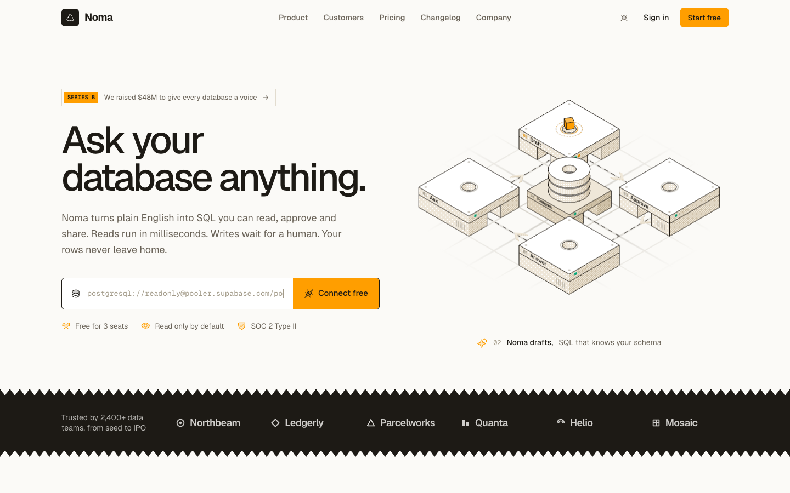
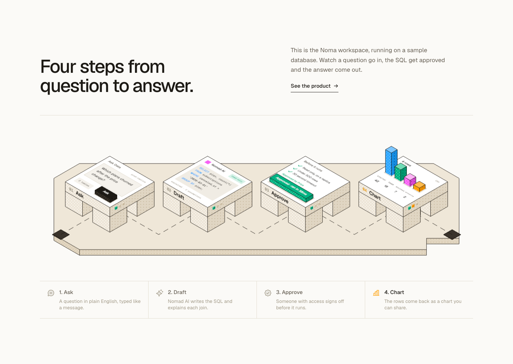
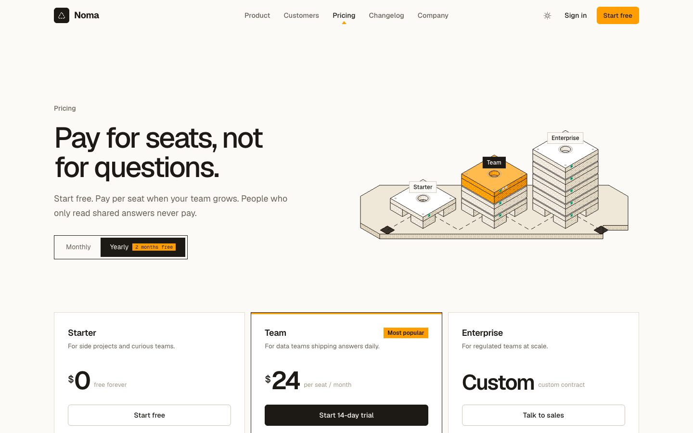
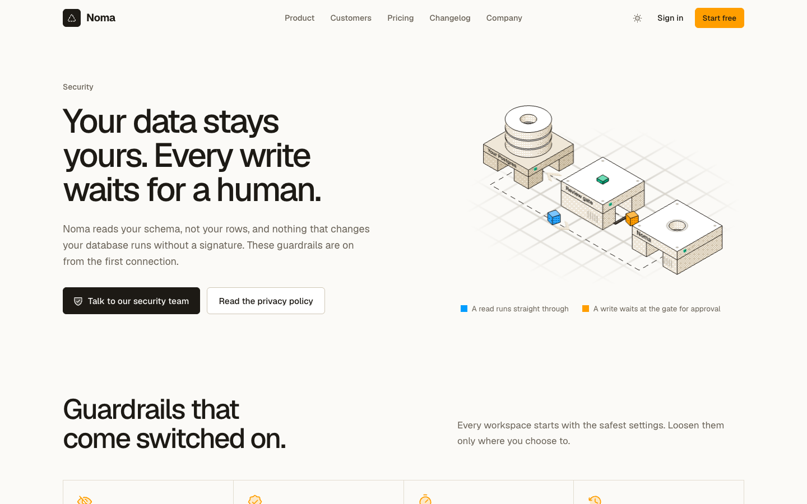
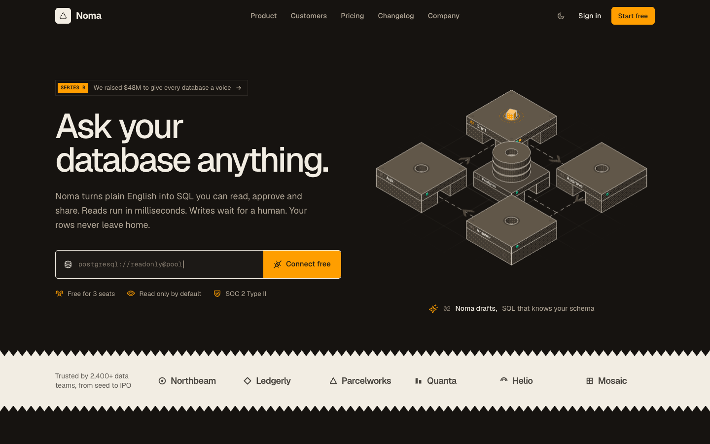

# Noma: a landing page template

A free, open-source landing page template for AI, data and developer products. It's dressed as **Noma**, a fictional "AI layer for Postgres", so you can see every section with real-feeling copy. Swap in your own name, words and colours and ship.

Built with Next.js 16, React 19 and Tailwind CSS 4, plus a small isometric WebGL kit that draws every illustration like a printed engraving.

[](https://vercel.com/new/clone?repository-url=https%3A%2F%2Fgithub.com%2Fmotiveo-co%2Fnoma-landing)



## Contents

- [What's inside](#whats-inside)
- [Screenshots](#screenshots)
- [Use this template](#use-this-template)
- [Make it yours](#make-it-yours)
- [Environment variables](#environment-variables)
- [Deploying to Vercel](#deploying-to-vercel)
- [Project structure](#project-structure)
- [The isometric WebGL kit](#the-isometric-webgl-kit)
- [Social cards](#social-cards)
- [Design rules](#design-rules)
- [Accessibility and performance](#accessibility-and-performance)
- [Tech stack](#tech-stack)
- [Credits and licenses](#credits-and-licenses)
- [Contributing](#contributing)

## What's inside

- **Twelve ready pages.** Home, product, pricing, customers, company, changelog, book a demo, an announcement post, security, status, privacy, terms and a 404. Every page is prerendered as static HTML.
- **Isometric scenes in WebGL, not stock art.** Every illustration is a live three.js scene with a true isometric camera. Surfaces are shaded in three tones with ordered (Bayer) dithering and outlined in ink, in both light and dark themes.
- **Motion with a reason.** Anything that moves rides a fixed route. Packets travel through real doorways cut into boxes, climb shafts through lids and sink into holes in the floor. Nothing pops in, fades out or jumps back to the start.
- **A "how it works" that shows the product.** Four stations (Ask, Draft, Approve, Chart), each lid showing one piece of the UI: the question being typed, the SQL being drafted, the approve key being pressed, bars rising out of their slots.
- **UI painted onto 3D surfaces**, with text that shrinks or wraps to fit its field so it never spills over an edge.
- **HTML product mockups** for chat, approvals, alerts, tables, a SQL editor and a relationships map.
- **A social card for every page**, rendered from that page's own scene, plus a script to regenerate them after you rebrand.
- **Light and dark themes** set before first paint, so there is no flash.
- **Dithered stock portraits** rendered in the browser with the same print look as the scenes.
- **Official integration logos** for Postgres, Supabase, Neon, AWS, Google Cloud, Slack, Teams, Notion, Linear, GitHub and more.

## Screenshots

| How it works | Pricing |
| --- | --- |
|  |  |
| **Security** | **Dark theme** |
|  |  |

## Use this template

Click **Use this template** on GitHub, use the **Deploy with Vercel** button above, or clone it:

```bash
git clone https://github.com/motiveo-co/noma-landing.git my-site
cd my-site
npm install
npm run dev
```

Open [http://localhost:3001](http://localhost:3001). You need Node.js 20.9 or newer.

| Script | What it does |
| --- | --- |
| `npm run dev` | Starts the dev server on port 3001 |
| `npm run build` | Builds the production site |
| `npm run start` | Serves the production build on port 3001 |
| `npm run lint` | Runs ESLint, including the React Compiler rules |
| `npm run og` | Regenerates the social cards (see [Social cards](#social-cards)) |

## Make it yours

Everything on the site is placeholder content for the fictional company Noma: customers, investors, people, metrics, quotes and incidents. Here's where to change it.

| To change | Edit |
| --- | --- |
| Product name in the logo, titles and social cards | `SITE_NAME` in `src/lib/site.ts`, then search the copy for "Noma" |
| Logo mark and app icon | `LogoMark` in `src/components/site/ui.tsx` and `src/app/icon.svg` (export `favicon.ico` and `apple-icon.png` from it) |
| Colours | Tokens at the top of `src/app/globals.css` (`--accent` is the one orange) and the scene palettes in `src/components/gl/kit.tsx` |
| Fonts | `src/app/layout.tsx` |
| Pricing, testimonials, customers, team, roles, changelog, FAQs | `src/lib/content.ts` |
| Page copy | The page files in `src/app` and their sections in `src/components/home` and `src/components/pages` |
| Navigation and footer links | `src/components/site/nav.tsx` and `src/components/site/footer.tsx` (the social links are placeholders) |
| Integration logos | `src/components/site/brand-svgs.ts` and the lists in `src/components/home/sections.tsx` |
| Team photos | `public/people`, named after each person (`jane-doe.jpg`), with credits in `CREDITS.txt` |
| Where "Start free" and "Sign in" go | `NEXT_PUBLIC_APP_URL` (see below) |

Before you launch:

- **Replace the Privacy and Terms pages** with your own policies, reviewed by your counsel. The included text is a sample, not legal advice.
- **Wire the Status page** to your monitoring, or delete it. Its uptime and incidents are static sample data.
- **Delete the pages you don't need.** Each route is a folder in `src/app`. Remove its links from the nav, footer and `src/app/sitemap.ts`.
- **Regenerate the social cards** once your copy is in place.

## Environment variables

Both are optional. Copy `.env.example` to `.env.local` to set them locally.

| Variable | Used for | Default |
| --- | --- | --- |
| `NEXT_PUBLIC_APP_URL` | Where "Start free", "Sign in" and the connect form send people | `/contact` (the demo page) |
| `NEXT_PUBLIC_SITE_URL` | Absolute URLs in social cards, canonical links, `sitemap.xml` and `robots.txt` | Your Vercel production URL, or `http://localhost:3001` locally |
| `OG_STUDIO` | Set to `1` to serve the social card studio at `/og/<card>` | Off |

## Deploying to Vercel

1. Import the repository in Vercel, or use the **Deploy with Vercel** button. The Next.js preset is detected automatically; no build settings need changing.
2. Optionally add `NEXT_PUBLIC_APP_URL` and `NEXT_PUBLIC_SITE_URL` under Environment Variables.
3. Deploy.

On Vercel the site URL falls back to `VERCEL_PROJECT_PRODUCTION_URL`, so social cards and the sitemap point at the right domain before you set anything. The template is checked with `vercel build`, and every page comes out as static output.

`vercel.json` pins the framework to Next.js. If a project was created before the code was in the repository, Vercel can pick the "Other" preset and serve only the `public` folder, which shows up as a Vercel `404 NOT_FOUND` page. The pinned setting prevents that.

## Project structure

```text
src/
├── app/                      Routes. Each folder is a page with its own metadata and social card
│   ├── layout.tsx            Fonts, theme script, nav, footer, site metadata
│   ├── globals.css           Design tokens (light, dark, accent band) and utilities
│   ├── opengraph-image.png   Home social card (each route has its own)
│   ├── icon.svg, apple-icon.png, favicon.ico
│   ├── sitemap.ts, robots.ts
│   ├── og/[card]             Social card studio (only with OG_STUDIO=1)
│   └── product, pricing, customers, company, changelog, contact, blog/series-b,
│       security, status, privacy, terms
├── components/
│   ├── gl/                   The isometric WebGL kit and every scene
│   │   ├── kit.tsx           Stage, camera, dither shader, Solid, geometry hooks
│   │   ├── holes.ts          Boxes with doorways and shafts, rings
│   │   ├── parts.tsx         Decals, LEDs, devices, database stack, floor grid, routes, packets
│   │   ├── paint.ts          Drawing UI and text into textures (fitText, wrapText)
│   │   ├── devices.tsx       Home hero: the device rack
│   │   ├── steps.tsx         How it works: Ask, Draft, Approve, Chart
│   │   ├── rack.tsx          Pricing towers and status racks
│   │   ├── flows.tsx         Connect and the security review gate
│   │   ├── scenes.tsx        Architecture stack, city, funding, releases, 404 tray
│   │   └── lazy.tsx          Lazy-loaded exports, so three.js stays out of the first bundle
│   ├── home/                 Home sections, product mockups and the steps showcase
│   ├── og/                   Social card layout and the card list (cards.json)
│   ├── pages/                Sections for the other pages (pricing, legal, status, ...)
│   ├── shapes/               Path-cut frames and backdrops, zigzag edges
│   └── site/                 Nav, footer, buttons, portraits, brand logos
└── lib/
    ├── content.ts            Copy and sample data (plans, customers, changelog, team)
    ├── site.ts               Site name, description and URL
    └── theme.ts              Theme script and the circular theme reveal
public/people/                Stock headshots and their credits
scripts/og.mjs                Regenerates the social cards
docs/screenshots/             Images used in this README
```

## The isometric WebGL kit

Everything lives in `src/components/gl`. A scene is a React component that renders inside `<Stage>`.

### Stage, camera and shading

`Stage` sets up a transparent canvas with an orthographic camera looking from (1, 1, 1), so every scene is a true isometric view. `span` is how many world units fit across the canvas. The canvas stops rendering when it scrolls out of view and ignores the pointer, so scenes never fight the page.

`Solid` draws any geometry with the dither material and ink edges. Materials come in families (`paper`, `sand`, `ink`, `void`, `accent`, `green`, `blue`, `pink`), each a light, mid and dark tone. Lighting is a single direction, and the fragment shader picks a tone per pixel with a 4 × 4 Bayer threshold. Each family has a light and a dark palette, and the theme is read from the nearest `data-theme`, so scoped dark bands work.

### Holes, routes and packets

Moving things travel through real openings:

- `useTunnelBox(w, h, lid, channel, sides, shaft)` in `holes.ts` builds a box whose lower part has channels cut from the given sides to the centre, and whose lid has a round shaft.
- `Route` in `parts.tsx` builds a looping path from straight runs, eased climbs and holds. Keys can carry a tag (for example `s2`), and a scene reads the latest tag to know which step it is on.
- `Packet` rides a route forever. Give it `clipBelow` and it disappears cleanly under a surface, so it can rise out of a hole or sink into one.

```tsx
const route = new Route().start(v(0, below, 0)).to(v(0, ride, 0), 1, true).to(v(4, ride, 0), 2.4).hold(1);
<Packet keys={route.keys} cycle={route.cycle} clipBelow={plateTop} onTag={setStep} />;
```

### Painting UI onto surfaces

`UiSlab` is a box whose top face is a canvas texture, and `Decal` lays a painted plane onto any face. Painters receive the face size in world units and draw with the helpers in `paint.ts`. Use `fitText` for single lines and `wrapText` for paragraphs, so text never runs past its field.

### Adding a scene

1. Build it in a file under `gl/` from `Stage`, `Solid` and the parts above.
2. Export it lazily from `gl/lazy.tsx` with `next/dynamic` and `ssr: false`.
3. Put it in a sized parent: `<div className="relative aspect-[4/3]"><MyScene className="absolute inset-0" /></div>`.

## Social cards

Each route has an `opengraph-image.png` (1200 × 630) and an `opengraph-image.alt.txt` beside its `page.tsx`. Next.js picks them up and adds the right tags; routes without a card use the home card. Each card is a frame of that page's own scene with its headline.

After you change copy, colours or scenes, regenerate them:

```bash
npx playwright@1 install chromium                      # once
OG_STUDIO=1 npm run build && OG_STUDIO=1 npm run start   # serves the studio at /og/<card>
npm run og                                             # in a second terminal
npm run og -- pricing security                         # or just some cards
```

Card copy and scenes are in `src/components/og/card.tsx`. Routes, the moment to capture (in milliseconds) and alt text are in `src/components/og/cards.json`. The studio is off in normal builds, so `/og` returns a 404 in production.

## Design rules

The template keeps to a short list of rules. They're worth keeping, or at least breaking on purpose.

- Corner radius between 0 and 6px.
- No shadows. The faint focus ring is the only exception.
- No decorative gradients. Fades are used only as masks.
- Geist for everything, Geist Mono for code and numbers. No serif.
- Phosphor icons in the duotone weight, used where they help a reader scan.
- Warm neutrals with one accent, `#ff9e00`, and light and dark themes for every surface.
- Isometrics carry no icons, and nothing in them pops in or out.
- Copy is short, specific and benefit-led. No em dashes or en-dash ranges.

## Accessibility and performance

- `prefers-reduced-motion` is respected: smooth scrolling is turned off and every scene settles on a still frame that still tells its story.
- Scenes are decorative and ignore the pointer. Everything they show is also written in the page text.
- three.js loads after first paint through `next/dynamic`, and each canvas only renders while it is on screen.
- Every page is prerendered as static HTML.

## Tech stack

| Area | Choice |
| --- | --- |
| Framework | [Next.js 16](https://nextjs.org) (App Router, static pages, Turbopack) |
| UI | React 19, TypeScript |
| Styling | [Tailwind CSS 4](https://tailwindcss.com) |
| 3D | [three.js](https://threejs.org) and [React Three Fiber](https://r3f.docs.pmnd.rs) |
| Motion | [Motion](https://motion.dev) and [Lenis](https://lenis.darkroom.engineering) |
| Icons | [Phosphor](https://phosphoricons.com) (duotone) |
| Fonts | [Geist and Geist Mono](https://vercel.com/font) through `next/font` |

## Credits and licenses

- **Code:** MIT, see [LICENSE](LICENSE).
- **Fonts:** Geist and Geist Mono by Vercel, SIL Open Font License, loaded through `next/font`.
- **Icons:** [Phosphor Icons](https://phosphoricons.com), MIT.
- **Integration logos:** from the CC0 [svg-logos](https://github.com/gilbarbara/logos) collection. The logos are trademarks of their owners and appear only to show integrations; check each brand's guidelines before using them on a live site.
- **Photos:** headshots from [Unsplash](https://unsplash.com), under the [Unsplash License](https://unsplash.com/license), not MIT. Photographer credits are in `public/people/CREDITS.txt`.
- **Content:** Noma and every company, person, quote and figure on the site are fictional.

## Contributing

Issues and pull requests are welcome. Before opening a pull request:

```bash
npm run lint
npm run build
```

Please check changes in light and dark themes and at a 390px wide viewport, and keep to the [design rules](#design-rules).

## License

[MIT](LICENSE) © Motiveo
